# Pocket Ledger Sprint 1 UAT results

We ran part of the agreed test suite and did not record an acceptance decision. [Lab 6 Part B #53](https://github.com/CPE334-Pockit/Pockit/issues/53)

- We tested [`37593da`](https://github.com/Palapluem/pocket-ledger/commit/37593da1cb3cd881e6b22845a2b4a929dbf6bc8e) on the [Pocket Ledger deployment](https://pocket-ledger-468473091761.asia-southeast3.run.app/). Health reported the expected commit and a healthy database.
- The [partner handoff](../requirements/uat-instructions.md) defines the cases. We did not record who ran each case.
- The table links to key evidence. Screenshots are grouped by case under `screenshot/`; JSON responses and text logs are grouped under `artifacts/`.

## Case results

| Case | Result | What we observed | Key evidence |
| --- | --- | --- | --- |
| UAT-01 Finance journey | Observed; evidence gaps | Opening balance 10,000; salary 20,000; card charge 1,200 split 700/500; repayment 500. Final bank 29,500, card debt 700, income 20,000, expense 1,200, three transactions. Amounts in THB. Some intermediate screenshots were missed. | [Opening balance](screenshot/uat-01/EV-UAT01-02.png) [Overview](screenshot/uat-01/EV-UAT01-07.png) [History](screenshot/uat-01/EV-UAT01-08.png) |
| UAT-02 Allocation mismatch | Observed; evidence gap | Payment and receipt mismatches were rejected. Final state matched the baseline; no separate snapshot between attempts. | [Payment](screenshot/uat-02/EV-UAT02-01.png) [Receipt](screenshot/uat-02/EV-UAT02-03.png) [Final state](screenshot/uat-02/EV-UAT02-final-overview.png) |
| UAT-03 Amount and date limits | Observed with deviations | Overpayment, overdraft, invalid amounts and invalid dates were rejected. Final state matched the baseline. The first overpayment used the default date rather than the fixture date; per-attempt history snapshots were incomplete. | [Amount observations](artifacts/uat-03/UAT03-observations.txt) [Future-date rejection](screenshot/uat-03/EV-UAT03-08-receipt.png) [Final state](screenshot/uat-03/EV-UAT03-final.png) |
| UAT-04 User ownership | Partial | Bob's Overview showed only his own state. Alice's transaction lookup returned 404. No direct Bank detail result was recorded; write checks were skipped. | [Bob's Overview](screenshot/uat-04/EV-UAT04-B1-overview.png) [Alice's post-read state](screenshot/uat-04/EV-UAT04-05-A1-current.png) |
| UAT-05 Administrator privacy | Partial | Finance routes redirected Admin; finance API reads returned 403. The user list contained identity/access fields only. Alice was denied Manage Users access. Administrator write checks were skipped. | [Finance detail denied](screenshot/uat-05/EV-UAT05-admin-detail.png) [User list fields](artifacts/uat-05/UAT05-admin-user-fields.txt) [Alice denied](screenshot/uat-05/EV-UAT05-A1-admin-ui.png) |
| UAT-06 Disable and re-enable | PASS | Alice 2's disabled status persisted on reload and sign-in was refused. The account was re-enabled and sign-in worked again. | [Disabled](screenshot/uat-06/EV-UAT06-disabled.png) [Rejected sign-in](screenshot/uat-06/EV-UAT06-login-refused.png) [Restored](screenshot/uat-06/EV-UAT06-login-restored.png) |
| UAT-07A Fresh session | PASS | After signing in again in a fresh browser session, we saw the same three transactions in the same order, with matching IDs, amounts, and allocations. | [Before](artifacts/uat-07/UAT07A-before.json) [After](artifacts/uat-07/UAT07A-after.json) [Repayment](screenshot/uat-07/EV-UAT07A-detail-0-full.png) [Charge](screenshot/uat-07/EV-UAT07A-detail-1-full.png) [Receipt](screenshot/uat-07/EV-UAT07A-detail-2-full.png) |
| UAT-07B Reported restart | Data matched; restart reported | After the reported restart, the commit was unchanged and the three transaction records matched the baseline exactly. We did not independently verify the restart time or revision. | [Baseline](artifacts/uat-04/UAT04-05-A1-current.json) [After](artifacts/uat-07/UAT07B-after.json) [Overview](screenshot/uat-07/EV-UAT07B-overview.png) |
| UAT-08 Identity and access | Observed | The app gave the same error for a wrong password and an unknown email. Valid sign-in worked; sign-out and direct Overview access returned to sign-in. Three anonymous finance endpoints returned 401. | [Wrong password](screenshot/uat-08/EV-UAT08-wrong-password.png) [Anonymous response](screenshot/uat-08/EV-UAT08-anonymous-accounts.png) |
| UAT-09 Repeat submission | PASS | A double-click saved exactly one THB 100 receipt. Bank and income each increased by THB 100. | [Overview](screenshot/uat-09/EV-UAT09-overview.png) [History](screenshot/uat-09/EV-UAT09-history.png) |
| UAT-10 Keyboard and layout | Observed | Tab order and visible focus were checked. Tab/Enter sign-in used automated password insertion. No clipping, overlap or horizontal overflow was observed at 390, 768 or 1280 px on the tested pages. Bob's empty-history messages matched expectations. | [Focus log](artifacts/uat-10/UAT10-keyboard-focus.txt) [390 px payment](screenshot/uat-10/EV-UAT10-payment-390-full.png) [Empty history](screenshot/uat-10/EV-UAT10-empty-history.png) |

## Limits on acceptance

- UAT-04 and UAT-05 cover read denials only. The write checks did not run.
- UAT-07B confirms matching data after a reported restart. We did not independently verify the restart time or revision.
- UAT-01 to UAT-03 have gaps noted in the results table.

## Screenshot evidence

### UAT-01 final balances

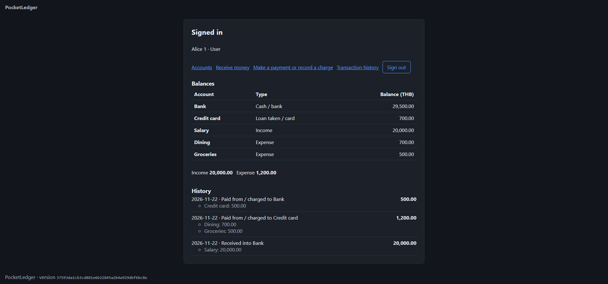

UAT-02 and UAT-03 Validation

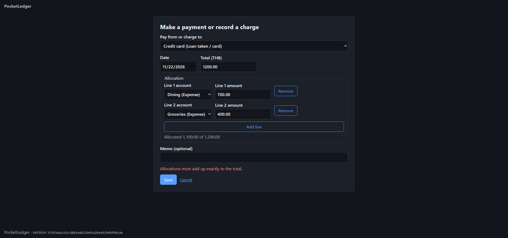

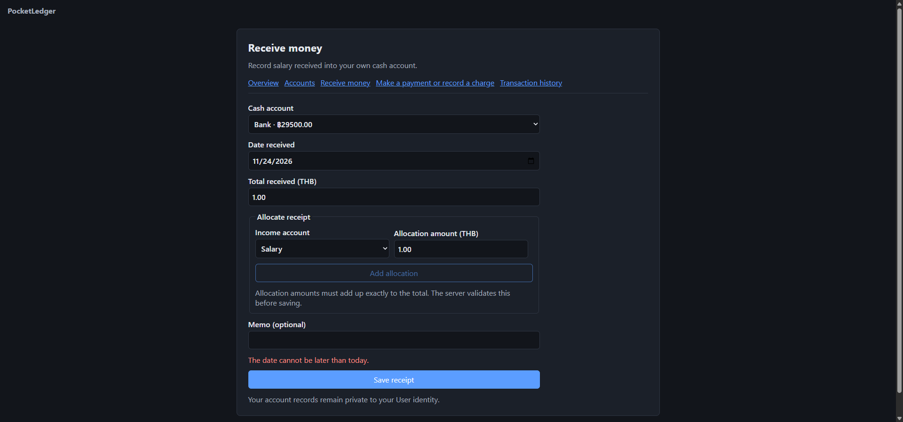

UAT-04 to UAT-06 Roles and access

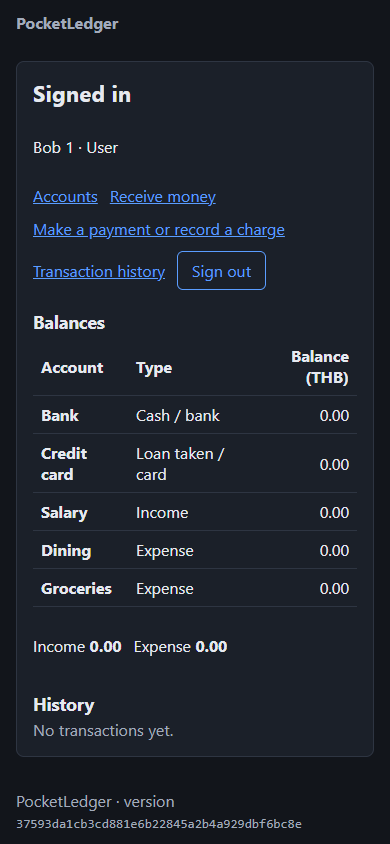

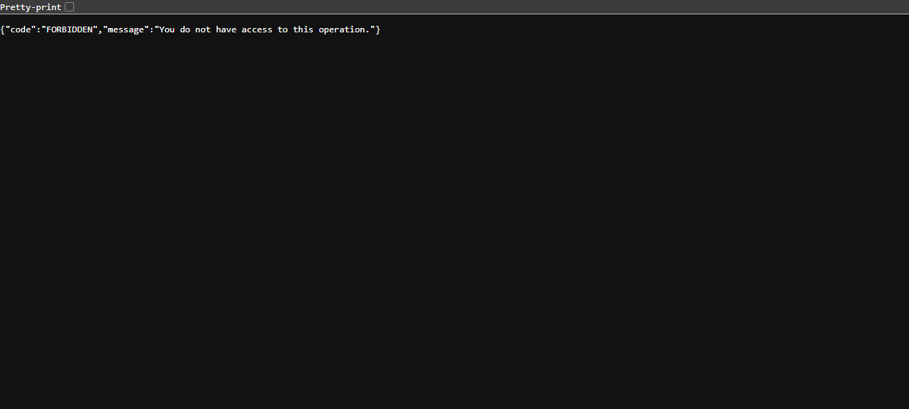

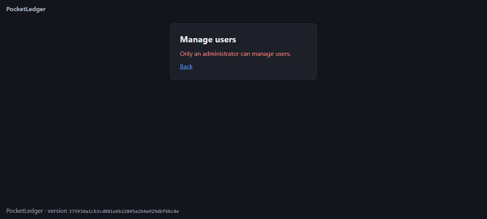

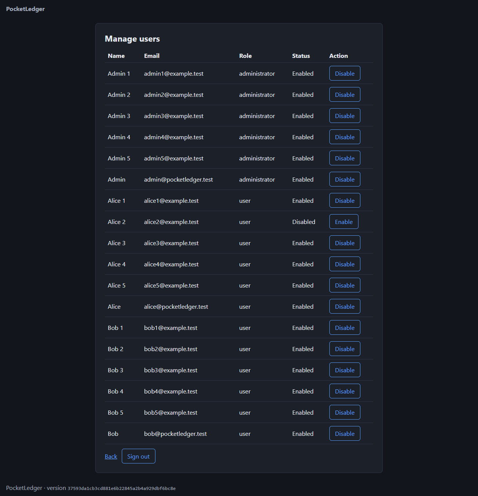

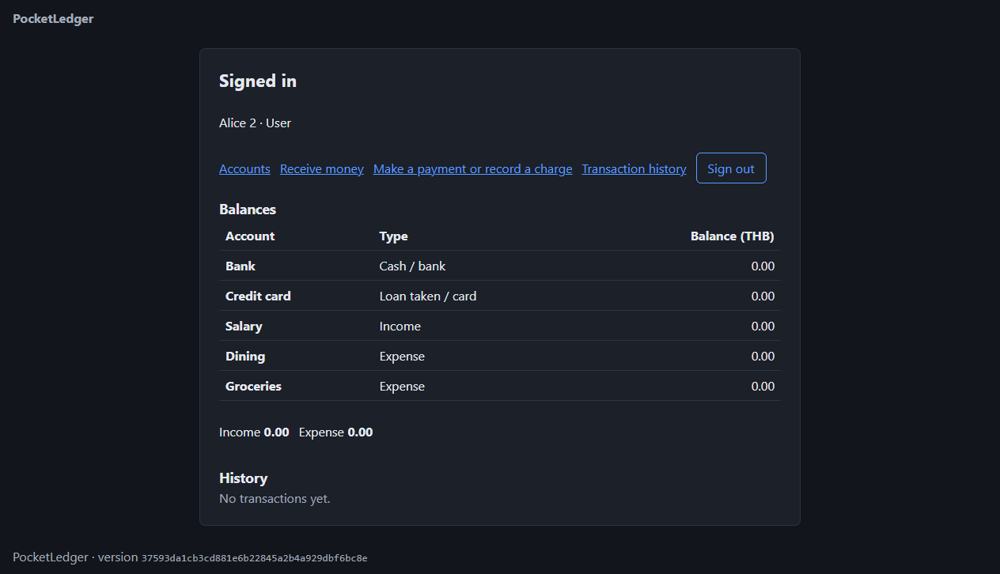

UAT-07 Persistence

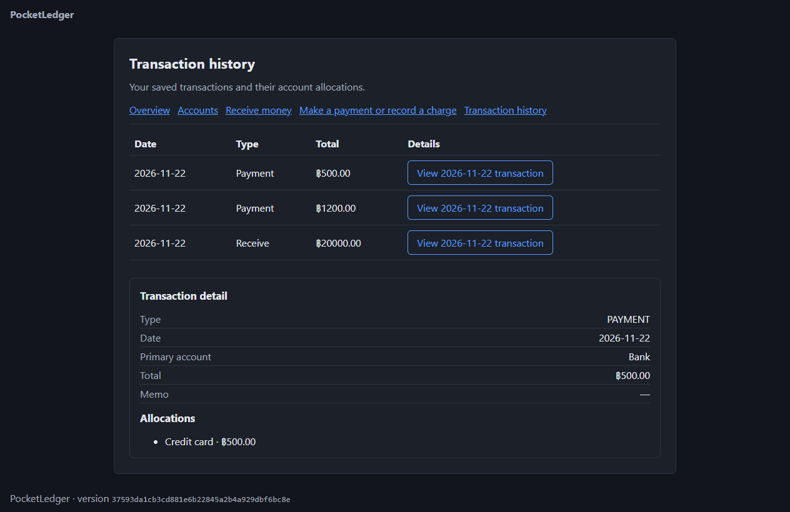

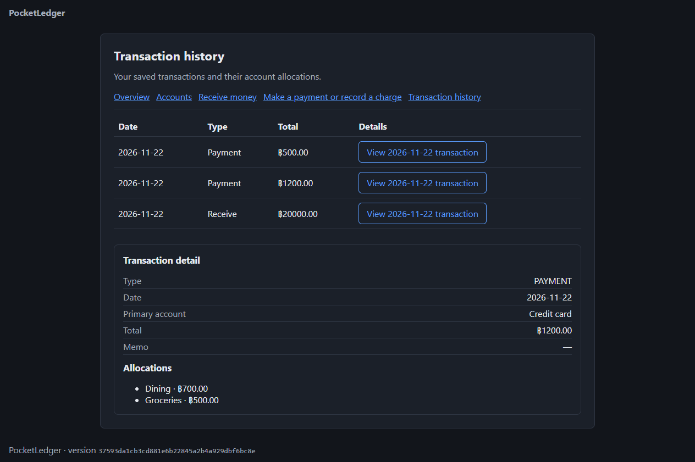

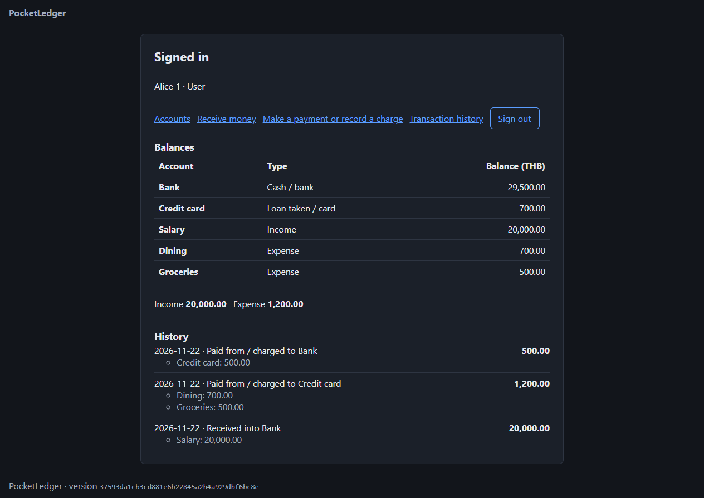

UAT-08 to UAT-10 Sign-in, duplicate submission, and layout

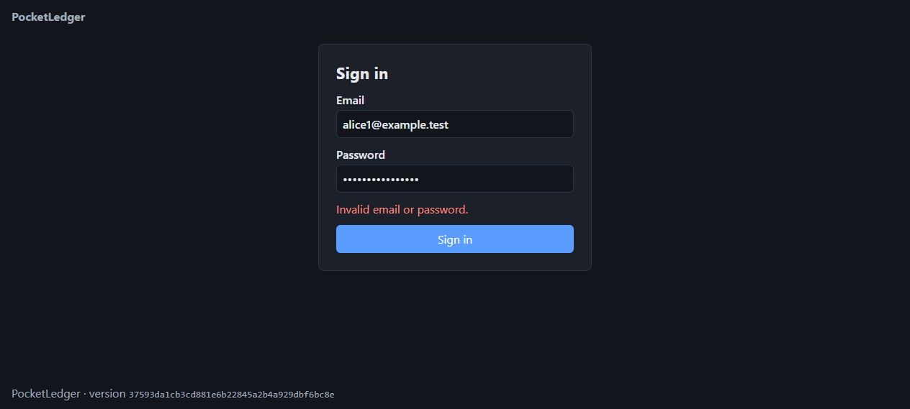

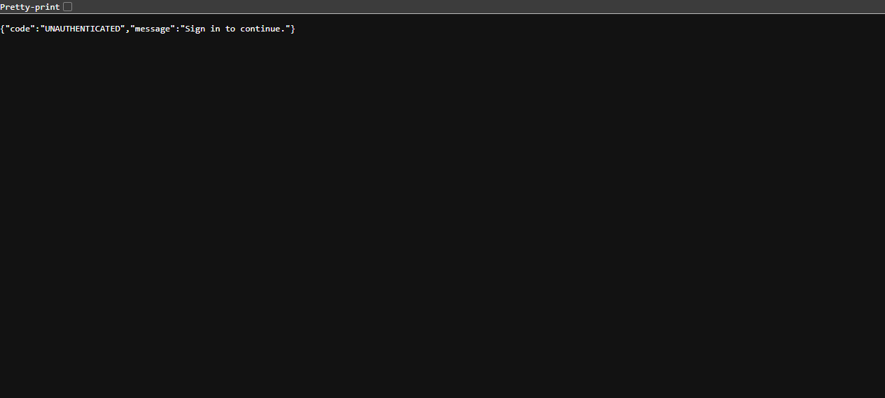

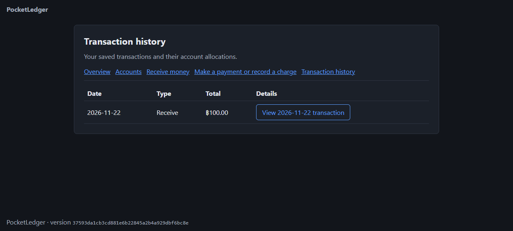

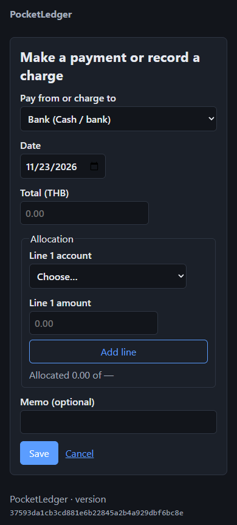

## Automated test evidence

 [Pocket Ledger CI](https://github.com/Palapluem/pocket-ledger/actions/runs/44885832238) on the tested commit passed cross-user transaction write denial (TEST-21) and Administrator transaction creation denial (TEST-08). It does not replace the skipped live write checks or verify opening-balance denial.
